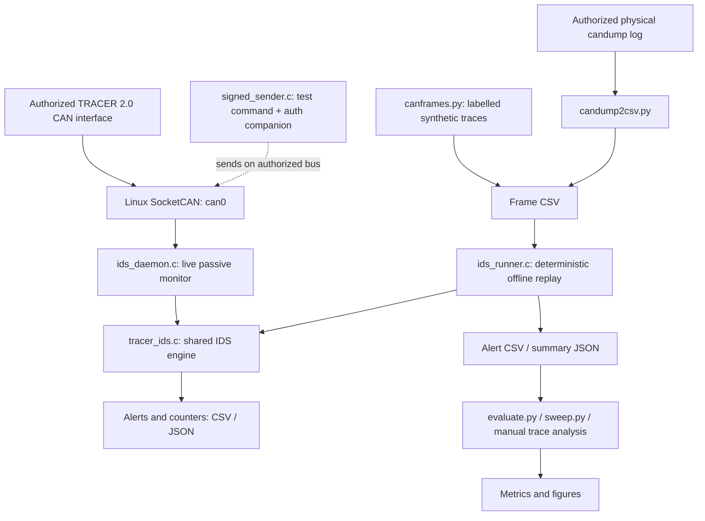

# TRACER-CAN-IDS

**Protocol-aware CAN intrusion detection and HMAC-SHA-256 authentication monitoring for the AgileX TRACER 2.0 unmanned ground vehicle**

> **Project status:** Research prototype (v3) · **Platform:** Linux / SocketCAN · **Evaluation:** Offline regression tests, generated CAN traces, and support for archived physical captures
>
> **Important:** This is a **passive monitoring system**, not an inline security gateway. Its alerts do **not** prevent the unmodified TRACER controller from receiving or acting on CAN commands. Do not use the prototype as a replacement for hardware safety controls or receiver-enforced authentication.

## Overview

Commercial unmanned ground vehicles (UGVs) can expose CAN interfaces for motion control, operating-mode selection, and status reporting. Classical CAN provides message identifiers and arbitration but does not natively authenticate the transmitting node. A device with access to the bus can therefore transmit frames that resemble legitimate control traffic.

**TRACER-CAN-IDS** is a research implementation that examines this attack surface on the **AgileX TRACER 2.0**. It combines:

- A **rule-based intrusion detection engine** grounded in documented and observed CAN identifiers, timing, and command semantics.
- **HMAC-SHA-256 companion-frame monitoring** for selected commands, including a sequence-based freshness check.
- A **live SocketCAN monitor** and a **deterministic offline replay harness** using the same C detection engine.
- Reproducible **software regression tests, synthetic-trace evaluations, sensitivity sweeps, host-side authentication benchmarks, and figures**.
- Tools to **convert and inspect authorized physical CAN recordings**, with explicit limitations on physical event scoring.

The project is intended for **academic research, defensive evaluation, education, and controlled laboratory experiments**. It is **not production-ready** or a general-purpose IDS for arbitrary CAN devices.

### Contents

- [System architecture](#system-architecture)
- [Security model and detection rules](#security-model-and-detection-rules)
- [Authentication companion-frame format](#authentication-companion-frame-format)
- [Repository structure](#repository-structure)
- [Requirements](#requirements)
- [Quick start: reproduce the software evaluation](#quick-start-reproduce-the-software-evaluation)
- [Complete offline experiment: reproduce every available software result](#complete-offline-experiment-reproduce-every-available-software-result)
- [Offline CAN-trace replay](#offline-can-trace-replay)
- [Reusing the detection engine](#reusing-the-detection-engine)
- [Physical TRACER 2.0: live observation, capture, then offline replay](#physical-tracer-20-live-observation-capture-then-offline-replay)
- [Configuration and default thresholds](#configuration-and-default-thresholds)
- [Reproducibility and interpretation of results](#reproducibility-and-interpretation-of-results)
- [Security, safety, and limitations](#security-safety-and-limitations)
- [Research manuscript and AI assistance](#research-manuscript-and-ai-assistance)
- [Contributing and reuse](#contributing-and-reuse)

## System architecture



**Two execution paths use the same detection logic:**

1. **Live monitoring:** `ids_daemon` reads CAN frames from an authorized SocketCAN interface, passes them to `ids_feed()`, performs timeout processing through `ids_tick()`, and records alerts.
2. **Offline evaluation:** `ids_runner` replays timestamped CSV frames through the same engine without using wall-clock timing. Python scripts generate test vectors, invoke the runner, score alerts, and create plots.

The **authenticated sender** demonstrates how selected command frames can be followed by a separate authentication frame. **The robot's original controller does not verify that companion frame**; verification happens at the passive monitor.

## Security model and detection rules

The baseline attacker is assumed to have **physical or otherwise authorized test access to the CAN bus** and knowledge of documented frame formats, but not the shared experimental HMAC key. This repository evaluates specified traffic patterns; it does not establish protection against all adversaries or attack combinations.

| Rule / alert | What the monitor checks | Important interpretation |
|---|---|---|
| R1 · `FLOOD` | Excessive traffic rate for a CAN identifier | Detects a traffic anomaly; it does **not** establish that the robot suffered denial of service. |
| R2 · `MODE_CHANGE` / `NO_AUTH` | Mode-command transitions (`0x421`) and their authentication | Under the default authentication-aware configuration, an unsigned mode command yields `NO_AUTH`; a validly authenticated transition is not automatically malicious. |
| R3 · `VEL_JUMP` | Large change between successive linear-velocity commands (`0x111`) | Threshold-based plausibility check; legitimate operation may also produce abrupt changes. |
| R4 · `REPLAY` / `STALE_SEQ` | Replay-related conditions, including stale authenticated sequence values | `STALE_SEQ` identifies a previously used/non-fresh sequence even when the MAC is valid. |
| R5 · `UNKNOWN_ID` | Identifier absent from the TRACER-specific allowlist | Does not identify the sender of a frame that uses an allowed identifier. |
| R6 · `NO_AUTH` | Selected commands missing a valid companion within the configured window | Detection only; does not block the command at the controller. |
| R7 · `BAD_MAC` | Companion fails HMAC verification | The tag is only 32 bits; security depends on key protection and threat assumptions. |
| R8 · `BURST` | Nontrivial motion command after a sufficiently long idle interval | Context-dependent warning, not proof of compromise. |
| R9 · `BRUTE_FORCE` | Repeated failed companion-tag checks within a window | Reports repeated invalid-MAC attempts; does not imply key recovery. |

The default **14-identifier allowlist** and protocol identifiers are defined in [`tracer_ids.h`](tracer_ids.h). Notable identifiers include `0x111` (motion command), `0x112` (project-specific authentication companion), `0x211` (system status), `0x221` (motion feedback), `0x241` (RC-transmitter state), `0x421` (mode setting), and `0x441` (error clearing). The original `0x111` byte 7 is **reserved**; it is **not** a native rolling counter.

## Authentication companion-frame format

The prototype adds a separate **8-byte CAN frame at ID `0x112`** to selected host-to-robot commands:

| Command ID | Prototype monitoring scope |
|---|---|
| `0x111` | Motion command |
| `0x421` | Operating-mode command |
| `0x441` | Error-clear command |

The MAC input is assembled as **2 bytes of CAN ID + 8 bytes of command payload (zero-padded as necessary) + 2 bytes of sequence number**. The sender computes **HMAC-SHA-256**, and places the **first 4 bytes** in the companion frame.

| Companion byte(s) | Field | Length |
|---|---|---:|
| `0–3` | Truncated HMAC-SHA-256 tag | 4 bytes |
| `4–5` | Monotonic sequence value | 2 bytes |
| `6–7` | Auxiliary low-order timestamp | 2 bytes |

The timestamp field is **not authenticated and is not used for the freshness decision** in the current implementation. Sequence freshness is evaluated against the monitor's current sequence state. The **shared default key is hard-coded for reproducible testing** in [`tracer_ids.h`](tracer_ids.h) and mirrored by [`canframes.py`](canframes.py); **it must not be considered a production secret**. The implementation has no production-grade key provisioning, reboot synchronization, or receiver-side enforcement.

## Repository structure

The following files are present in this published source repository:

```text
.
├── tracer_ids.c / tracer_ids.h     # IDS rules, state and API
├── sha256.h                       # Standalone SHA-256 / HMAC-SHA-256
├── ids_daemon.c                   # Live SocketCAN monitor
├── signed_sender.c                # Authorized signed-command demonstration
├── ids_runner.c                   # Offline frame-CSV replay
├── test_v3.c                      # Eight C regression tests
├── bench_hmac.c                   # Host-side signing/verification benchmark
├── canframes.py                   # Labelled synthetic CAN traces
├── evaluate.py                    # Synthetic attack evaluation and Wilson CIs
├── sweep.py                       # Threshold sensitivity experiments
├── candump2csv.py                 # candump -L log to frame CSV
├── score_physical.py              # Preliminary capture-phase scoring
├── make_figures.py                # Figures generated from results files
├── Makefile                       # Compile and run regression tests
├── RUN_PROTOCOL.md                # Laboratory campaign protocol
├── AI_USAGE.md                    # AI assistance disclosure
└── README.md                      # This document
```

`.gitignore` excludes generated binaries, caches, and `results/` outputs. **Raw physical captures, their independent event annotations, and the paper's original physical dataset are not included in the current repository.** Some older documentation in the development kit referred to internal reviewer-response and reference files; those are not part of this published source snapshot.

## Requirements

For **offline reproduction** (no robot required):

- Ubuntu or another Linux distribution with **GCC**, **GNU Make**, and **Python 3**.
- Python packages **NumPy** and **Matplotlib** for figure generation. The core evaluation scripts otherwise use the Python standard library.
- No ROS, GPU, Jetson, robot, or CAN hardware is required for the software-only tests.

For **live observation** (optional):

- A TRACER 2.0 and a compatible, **authorized** USB-CAN/SocketCAN interface.
- Linux CAN networking and `can-utils` (`candump`) for traffic recording.
- An isolated, supervised laboratory environment with applicable motion safety precautions.

Check locally installed tools:

```bash
gcc --version
make --version
python3 --version
```

If you need isolated Python dependencies, create a virtual environment:

```bash
python3 -m venv .venv
source .venv/bin/activate
python -m pip install --upgrade pip
python -m pip install numpy matplotlib
```

> Ubuntu may require its `python3-venv` package before `python3 -m venv` works. No dependency lockfile is supplied; record Python and package versions when reporting reproduced results.

## Quick start: reproduce the software evaluation

These commands run **entirely offline** in the **repository root**.

### 1. Clone and build

```bash
git clone https://github.com/M-khalifa1/tracer-can-ids.git
cd tracer-can-ids
make
```

If the repository is private, cloning requires access to the `M-khalifa1` account or an authorized collaborator account. `make` compiles the C programs **in the repository root** and automatically runs the regression tests. To rerun just the tests:

```bash
./test_v3
# Expected summary for the reviewed v3 source:
# Result: 8 passed, 0 failed
```

The regression suite checks sequence handling, pending-authentication overwrite, stale-sequence detection, invalid-MAC escalation, authentication-aware mode changes, benign feedback, and configurable velocity thresholds. **Eight passing assertions are not equivalent to a measured detection rate on a real robot.**

### 2. Generate labelled synthetic attacks and score them

```bash
python3 evaluate.py
```

Expected outputs (created locally, not committed):

```text
results/atk_A1.csv ... results/atk_A9.csv  # Generated scenario traces (A3 not defined)
results/benign.csv                         # Generated benign traffic
results/metrics.json                       # Per-attack detection and Wilson 95% CIs
```

`evaluate.py` invokes the compiled `./ids_runner` and evaluates **A1, A2, A4–A9** using generated and labelled test events. It also reports an **alert-count-per-benign-frame metric** in a benign session; treat that metric as the script's defined proxy, **not an independently established frame-level classifier false-positive probability**. The example events are not independent physical runs.

### 3. Sweep detector thresholds

```bash
python3 sweep.py
# Output: results/sweeps.json
```

The sensitivity harness varies flooding, velocity-jump, idle/burst, and authentication-window settings while reprocessing test traces. **Interpret each curve according to the alert being scored**: for example, the current `burst_idle_ms` sweep scores `NO_AUTH` on its selected scenario, so it should **not** be reported as validated BURST-rule sensitivity without updating the scoring configuration. The repository does not currently produce a standalone ROC figure.

### 4. Benchmark authentication on your own host

```bash
mkdir -p results
./bench_hmac 200000 > results/hmac_bench_host.json
```

The benchmark reports signing distribution statistics (**min, mean, median, P99, max**) and verification execution-time statistics in microseconds; **the current verification input has a known sequence mismatch and does not establish successful verification time** (see the complete offline experiment below). It compares signing time to the **20,000 µs nominal command period**. The generated `platform` field initially contains a **`FILL_ME` placeholder**: replace it with your actual OS/CPU description before citing the numbers. These are **host computation measurements**, not CAN transmission, embedded execution, live alert latency, or end-to-end actuation delays. Results vary with host hardware and system load.

### 5. Generate figures

```bash
python3 make_figures.py
# Output: results/charts/*.png and *.pdf
```

Figures are created from available `results/metrics.json`, `results/sweeps.json`, and `results/hmac_bench*.json` files. Missing inputs are **skipped** with a message. These generated graphics describe **the input experiments**, not additional physical validation.

### 6. Clean the compiled programs (optional)

```bash
make clean
```

> **Reproduction boundary:** This workflow reproduces the **code-driven software experiments**. It **does not independently reproduce the physical-paper results** without the original CAN captures, operating-condition metadata, and event-level ground truth.

## Complete offline experiment: reproduce every available software result

This is the **recommended first experiment**. It executes entirely on an Ubuntu/Linux computer and **does not send any CAN frames to a robot**. All paths below are relative to the repository root. The commands generate fresh outputs under `results/`, which is excluded from Git by `.gitignore`.

### Experiment scope and evidence levels

| Experiment | Source/tool | What it verifies | What it **does not** verify |
|---|---|---|---|
| C regression suite | `make`, `test_v3` | Eight specified IDS behavior checks | Detection probability in an actual deployment |
| Synthetic attack cases | `evaluate.py`, `canframes.py`, `ids_runner` | Labeled A1, A2, A4–A9 event matching in generated CAN frames | Physical robot attack success or the original 211-event campaign |
| Synthetic benign trace | `evaluate.py` | Alert count per generated benign frame | An independently estimated operational false-positive probability |
| Threshold sweeps | `sweep.py` | R1/R3 settings and other current script outputs | Validated R8 `BURST` ROC; see the documented scoring mismatch |
| HMAC host microbenchmark | `bench_hmac.c` | Host-side signing times; diagnostic verification execution time | **Successful verification timing** with the current benchmark source (see below) |
| Research figures | `make_figures.py` | Figures derived from the locally generated JSON files | Figures independently reproducing archived physical measurements |

**Scenario count matters:** `evaluate.py` generates **30 labeled events for each of eight synthetic scenarios**, including A4. The paper's *physical* campaign instead describes 30 events in each of seven scenarios **plus one A4 flooding session** (211 occurrences). Do **not** equate the two populations.

### 0. Prerequisites and reproducibility metadata

Install the tools if they are missing. On Ubuntu, the optional package-installation step may require repairing an already-broken `apt`/`dpkg` state first; don't remove GPU or kernel drivers just to run this project.

```bash
# Optional installation, only if tools are missing:
sudo apt install build-essential python3 python3-venv python3-pip

# In the repository root (clone only if not already present locally):
# git clone https://github.com/M-khalifa1/tracer-can-ids.git
# cd tracer-can-ids
pwd
ls Makefile test_v3.c tracer_ids.c ids_runner.c evaluate.py sweep.py

# Capture implementation revision and tool versions used for this run.
mkdir -p results
{ date -u +'%Y-%m-%dT%H:%M:%SZ'; git rev-parse HEAD; \
  gcc --version | head -1; python3 --version; uname -a; } \
  | tee results/run_environment.txt
```

For figure generation, install the required Python plotting packages into a virtual environment if needed:

```bash
python3 -m venv .venv
source .venv/bin/activate
python -m pip install --upgrade pip
python -m pip install numpy matplotlib
python -m pip freeze > results/python_packages.txt
```

Use the same shell for subsequent commands if you activate the environment. A GPU, Jetson, ROS installation, TRACER robot, or CAN adapter is **not needed** for this offline experiment.

### 1. Build all C tools and run the regression suite

```bash
make clean
make 2>&1 | tee results/build_and_tests.log
./test_v3 | tee results/regression_tests.log
```

`make` builds `ids_daemon`, `signed_sender`, `ids_runner`, `bench_hmac`, and `test_v3` in the repository root, and automatically executes the C tests. The second invocation of `test_v3` preserves a standalone test log.

**Expected for the reviewed v3 baseline:**

```text
=== TRACER IDS v3 regression tests ===
...
Result: 8 passed, 0 failed
```

If compilation or any test fails, **stop** and record the failure; do not continue as though the detector revision were validated. These tests include missing authentication, stale sequence handling, invalid-tag escalation, operating-mode authentication, feedback whitelist behavior, and velocity-threshold changes.

### 2. Generate and evaluate all eight synthetic attack scenarios

```bash
python3 evaluate.py | tee results/synthetic_evaluation.log
python3 -m json.tool results/metrics.json > /dev/null
```

The evaluator builds a benign frame backbone and labeled attack-event streams using `canframes.py`, writes frame CSV files, invokes the compiled `./ids_runner`, and matches alert records to event time windows. It runs:

| Case | Generated condition | Expected detection category |
|---|---|---|
| A1 | Unauthenticated motion command | `NO_AUTH` |
| A2 | Unauthenticated mode command | `NO_AUTH` (or configured `MODE_CHANGE`) |
| A4 | Synthetic high-rate command traffic | `FLOOD` |
| A5 | Valid-MAC command with stale sequence | `STALE_SEQ` / `REPLAY` |
| A6 | Forged authentication companion | `BAD_MAC` / `BRUTE_FORCE` |
| A7 | Large change in requested velocity | `VEL_JUMP` |
| A8 | Repeated invalid MACs | `BRUTE_FORCE` / `BAD_MAC` |
| A9 | Unknown CAN identifier | `UNKNOWN_ID` |

**A3 is not defined** in the evaluated case list. The synthetic A5 setup is not automatically equivalent to the physical A5 sequence of frames or the literal authenticated-pair replay regression test.

Expected generated files include:

```text
results/atk_A1.csv ... results/atk_A9.csv   # No atk_A3.csv
results/atk_A1_al.csv ...                    # Alert CSV per scenario
results/benign.csv
results/benign_al.csv
results/metrics.json
results/synthetic_evaluation.log
```

Inspect the measured, **locally generated** results rather than copying numerical claims from the manuscript:

```bash
python3 - <<'PY'
import json
with open('results/metrics.json') as f:
    r = json.load(f)
for name, item in r['attacks'].items():
    print(f"{name}: {item['detected']}/{item['events']} events matched; "
          f"rate={item['detection_rate']}%; Wilson CI={item['ci95']}")
b = r['benign']
print('Benign:', b['false_positives'], 'alerts /', b['benign_frames'], 'frames')
PY
```

**Interpretation:** a passing 30/30 synthetic result means that the expected alert appeared within each constructed event's permitted time window. It does not establish 30 independent runs on physical TRACER hardware or detection against adaptive attackers. `metrics.json` calls the benign alert-count ratio `fpr_percent`; this is an alert-incidence proxy and is **not** necessarily a conventional frame-level false-positive rate.

### 3. Run threshold sensitivity and inspect each rule's actual target

```bash
python3 sweep.py | tee results/threshold_sweep.log
python3 -m json.tool results/sweeps.json > /dev/null
```

This produces `results/sweeps.json`. `flood_hz` scores `FLOOD` for A4 and `vel_jump` scores `VEL_JUMP` for A7. **Current limitation:** the `burst_idle_ms` sweep selects scenario A1 and scores `NO_AUTH`, **not** `BURST`. Therefore, its rows must **not** be cited as R8 `BURST` sensitivity. The `auth_win_us` sweep also requires careful interpretation because its chosen A1 event measures missing-authentication detection, not the full distribution of valid companion delays.

To make a publication-grade R8 study, create labeled benign *authenticated* resumption traces, score `BURST` directly, document the idle gaps and thresholds, and keep that additional experiment distinct from the output of the published `sweep.py`. Do not invent an ROC curve from metrics that are not generated by the software.

### 4. Run the HMAC benchmark — with a verification-validity check

```bash
./bench_hmac 200000 > results/hmac_bench_host.json
python3 -m json.tool results/hmac_bench_host.json > /dev/null
```

Record host CPU model, OS, compiler flags, CPU governor/load, and the executable commit. Replace the JSON `platform` placeholder in your research record with the **actual** hardware description.

**Known correctness issue in this revision:** `bench_hmac.c` constructs the final authentication tag using a nonzero sequence value, but assembles the verification frame with sequence bytes `00 00`. It also ignores the boolean result returned by `sign_check()`. Consequently, its `verify_us` statistics can time **failed** verification, not confirmed successful verification. **Do not cite these values as successful-authentication verification latency or as proof of real-time feasibility.** Fix the benchmark so the companion's sequence and tag match and explicitly assert `sign_check() == true`; then rebuild and rerun on the host identified in the paper. The signing timings also exclude CAN delivery, arbitration, scheduling, and controller actuation.

### 5. Produce figures from the generated JSON artifacts

```bash
python3 make_figures.py | tee results/figure_generation.log
find results/charts -maxdepth 1 -type f | sort
```

Expected when the corresponding JSON inputs exist: `fig_detection_ci`, `fig_sensitivity`, and `fig_hmac_overhead` as `.png` and `.pdf` files under `results/charts/`. Label the detection and threshold plots as **synthetic software results**. The HMAC overhead figure should not be used as evidence of successful verification timing until the benchmark is corrected and rerun.

### 6. Package your evidence and verify reproducibility

```bash
# Store basic hashes of generated results and the detector source.
sha256sum tracer_ids.c tracer_ids.h \
  results/metrics.json results/sweeps.json results/hmac_bench_host.json \
  | tee results/reproduction_sha256.txt

# Review results before archiving them outside the Git repository.
find results -maxdepth 2 -type f | sort
```

Retain `run_environment.txt`, the exact Git commit hash, stdout/test logs, all generated frame CSVs, alert CSVs, JSON metrics, figures, and the verification status of the HMAC benchmark. Generated files are under `results/` and normally ignored by Git. Share them only after reviewing possible confidential content and confirming the right to release them.

**Offline completion criteria:** C tests pass; labeled synthetic frame files and their alert CSVs exist; `metrics.json` and `sweeps.json` parse as JSON; the plots are generated; toolchain and commit are recorded; and every reported statistic is labeled with its **source experiment**. The original **211-event physical campaign is not reproduced by this offline-only workflow**.

### 7. Optional: exercise the live IDS using virtual CAN (no physical robot)

If your Ubuntu kernel provides `vcan`, this is a useful **full live-pipeline integration exercise** that generates traffic, captures it, checks it online, and replays it offline **without attaching the TRACER robot**. Use `vcan0`, **never `can0`**, for this test. A virtual CAN bus is not a timing-equivalent physical CAN network and does not reproduce arbitration or robot-controller behavior.

Create the isolated virtual interface:

```bash
sudo modprobe vcan
sudo ip link add dev vcan0 type vcan
sudo ip link set vcan0 up
ip -details link show vcan0
```

Open **three terminals** in the repository root. Start the two receivers first.

**Terminal A — virtual bus recording**

```bash
mkdir -p results
candump -L vcan0 > results/vcan_session.log
# Leave running until the sender finishes, then Ctrl+C.
```

**Terminal B — live passive IDS**

```bash
mkdir -p results
sudo ./ids_daemon vcan0 results/vcan_live_alerts.csv
# Leave running until after the sender finishes, then Ctrl+C.
```

**Terminal C — virtual test command sender**

```bash
sudo ./signed_sender vcan0
```

The demonstration sender executes its built-in **mode + motion + stop command sequence** against the **virtual interface only**. Do not change `vcan0` to `can0` while following this offline exercise. The two receivers should observe frames on `vcan0`; a lack of security alerts from correctly signed commands is not a test failure by itself.

Once both receivers have stopped, replay the virtual capture:

```bash
python3 candump2csv.py results/vcan_session.log results/vcan_frames.csv
./ids_runner results/vcan_frames.csv results/vcan_replayed_alerts.csv suppress=0
wc -l results/vcan_session.log
```

Compare the *types* of live/offline alerts, keeping in mind that the daemon and runner use different time sources and timeout scheduling. Clean up **only the virtual interface** when finished:

```bash
sudo ip link set vcan0 down
sudo ip link del vcan0
```

This is a reusable integration test for the SocketCAN path and companion-frame format, but it **does not** validate physical command execution, controller acceptance, actual CAN bus load, or online P99 latency.

## Offline CAN-trace replay

`ids_runner` reads CSV files with the header:

```csv
ts_us,can_id,dlc,data_hex
1000000,0x111,8,00C8000000000000
```

Replay a previously prepared trace:

```bash
./ids_runner PATH_TO_FRAMES.csv results/replayed_alerts.csv
```

The runner writes an **alert CSV** and a **JSON summary** alongside it. Optional runtime configuration can be supplied as `key=value` arguments, for example:

```bash
./ids_runner PATH_TO_FRAMES.csv results/replayed_alerts.csv \
  flood_hz=200 vel_jump=600 auth_win_us=8000 seq_window=64 suppress=0
```

Use the same input CSV, detector revision, and configuration for meaningful comparisons. The replay engine does not require a CAN interface or wall-clock scheduling.

## Reusing the detection engine

The reusable core is [`tracer_ids.c`](tracer_ids.c) with [`tracer_ids.h`](tracer_ids.h) and [`sha256.h`](sha256.h). The `ids_daemon` and `ids_runner` programs are **adapters** around this engine, not alternative detection implementations.

Typical integration sequence (illustrative C fragment, not a standalone program):

```c
IDSConfig cfg;
ids_default_config(&cfg);
cfg.log_suppress = false;  /* Retain alerts during evaluation. */

IDS detector;
ids_init_cfg(&detector, DEFAULT_HMAC_KEY, &cfg);

/* For each validated CAN frame, with an appropriate microsecond timestamp: */
ids_feed(&detector, can_id, dlc, data, timestamp_us);

/* Periodically advance pending-authentication timers, including while idle: */
ids_tick(&detector, current_timestamp_us);
```

Applications may attach a CSV stream with `ids_set_csv()` and write counters using `ids_write_json()`. Because pending-authentication expiration and other conditions can emit alerts **inside** the engine, examine its output/counters rather than assuming one returned `Alert` always represents every event.

**Before adapting to another robot or CAN implementation**, revise and validate the identifier allowlist, command payload semantics, authentication policy, timing thresholds, test vectors, and safety model. Neither the default key nor the TRACER-specific rules should be reused unchanged for a production device.

## Physical TRACER 2.0: live observation, capture, then offline replay

This section is **optional**. It describes a safe **passive** physical-data acquisition path for an authorized laboratory TRACER unit, followed by reproducible processing on Linux. The instructions do **not** recreate all the paper's scripted physical attacks; the corresponding original injection programs, raw capture, and independent event-level labels are not part of this GitHub source snapshot.

### A. Hardware and safety preflight

Use a TRACER 2.0, manufacturer-compatible USB-CAN adapter/cable, Ubuntu/Linux host with SocketCAN support, and physical access to emergency stop. Verify the manufacturer pinout before energizing the system; never connect a CAN signal pin to auxiliary power. Carry out observation only under laboratory authorization and supervision, and avoid changing an active robot's CAN setup mid-mission.

Keep the initial trial **receive-only**. This project is a passive IDS, not a safety interlock. Running `signed_sender` is **not** required for any read-only steps below, and its example program can change control mode, drive forward at 200 mm/s for approximately 2 seconds, rotate at 300 mrad/s for approximately 1 second, and then request a stop. Do not use that program on a mobile robot without an independently approved motion test, safeguards, and a proven external stop path.

### B. Inspect and configure the authorized CAN interface

```bash
# On the Linux host with the authorized USB-CAN adapter connected:
ip -br link
lsusb
ip -details -statistics link show can0
```

Check the actual interface name (`can0` is an **example**). The documented TRACER CAN bitrate is **500000 bit/s**. If the interface is not already configured by your lab and can safely be taken down, a receive-only setup is:

```bash
sudo ip link set can0 down
sudo ip link set can0 type can bitrate 500000 listen-only on
sudo ip link set can0 up
ip -details -statistics link show can0
```

`listen-only` depends on adapter/driver support and **does not send CAN ACK frames**. Ensure the remaining bus nodes can operate without that adapter's acknowledgment. If configuration fails, do not silently fall back to transmit-capable mode; validate the driver, bus wiring, and laboratory requirements. Avoid configuring a bus already in operational use without permission. The `can-utils` package provides `candump` (on a healthy Ubuntu package manager: `sudo apt install can-utils`).

### C. Verify passive feedback before collecting evidence

```bash
candump can0
# Stop after a short observation using Ctrl+C.
```

You may observe status/feedback IDs such as `0x211`, `0x221`, or `0x241` when the robot is powered and sending telemetry. These are expected **examples**, not guaranteed output. If no frames arrive, inspect power, cabling, termination, bitrate, interface state, and counters before changing any controls.

### D. Record a timestamped physical session and run the live IDS

Open separate terminals from the repository root:

**Terminal 1 — raw CAN acquisition**

```bash
mkdir -p results
candump -L can0 > results/physical_session.log
# Ctrl+C to stop and flush the recording.
```

**Terminal 2 — passive live IDS**

```bash
mkdir -p results
sudo ./ids_daemon can0 results/live_alerts.csv
# Ctrl+C to end and write the aggregate JSON statistics.
```

Expected files include `results/physical_session.log`, `results/live_alerts.csv`, and `results/live_alerts_stats.json`. The daemon's live timers and scheduler are not identical to the offline runner's timestamp-driven timeout processing; alert counts may differ. Both listen to the same bus through separate sockets, but this does not prove lossless acquisition or bounded online latency.

**Terminal 3 — capture metadata**

```bash
{ date -u +'%Y-%m-%dT%H:%M:%SZ'; git rev-parse HEAD; \
  ip -details -statistics link show can0; uname -a; } \
  > results/physical_environment.txt
```

Record manually: robot unit/firmware, interface/driver, adapter, experimental operator, safety configuration, start/end time, whether the test was benign or contained **approved** events, and the exact IDS thresholds. Do not write a physical attack outcome based only on an alert.

### E. Replay the captured physical frames offline

After stopping the capture, in the repository root:

```bash
wc -l results/physical_session.log
sha256sum results/physical_session.log \
  > results/physical_session.sha256
python3 candump2csv.py \
  results/physical_session.log results/physical_frames.csv

./ids_runner results/physical_frames.csv results/physical_alerts.csv \
  seq_window=64 require_auth_mode=1 suppress=0

head -n 5 results/physical_frames.csv
head -n 5 results/physical_alerts.csv
```

`candump2csv.py` produces a frame CSV in the schema `ts_us,can_id,dlc,data_hex`, with timestamps relative to the first captured frame. `ids_runner` writes `physical_alerts.csv` and a same-basename `.json` summary. The decoded frames and alert files allow **inspection of a new authorized physical recording**, but not automatic recreation of the original paper's outcomes.

### F. Reproducing a *labeled* physical campaign (requires additional evidence)

To score attack-event detection scientifically, preserve a timestamped ground-truth manifest with **one row per independent scripted event**, including fields such as:

```csv
event_id,scenario,start_us,end_us,expected_alert,operator_note
```

Use the same relative time reference as `physical_frames.csv`, preserve the exact raw log, and verify event boundaries against injected-command and feedback timestamps. Match each event to a corresponding alert within a justified and disclosed tolerance, resolve duplicate alerts, and retain unmatched events. Include separate benign operating periods and clearly state their denominators.

**A known limitation of `score_physical.py`:** it segments *entire* CAN traffic by frame-free gaps (default 1.5 s) and caps the number of matching alerts at a declared repetition count. Background feedback can defeat gap segmentation, and capping is **not** an independent one-to-one matching test. The script does **not** currently consume the event manifest above. Use its output as **exploratory phase-level diagnostics only**, not standalone proof of 211/211 event-level detection.

If — and only if — your real capture has **verified** phases separated by frame-free gaps, an exploratory invocation is:

```bash
python3 score_physical.py results/physical_session.log \
  'benign,A1,A2,A4,A5,A6,A7,A8,A9' \
  --reps 'benign:1,A1:30,A2:30,A4:1,A5:30,A6:30,A7:30,A8:30,A9:30'
```

The phase names and repetition counts above are a **historical study protocol**, not labels to attach to an arbitrary benign recording. If the script warns about a phase-count mismatch, stop and correct the annotations/segmentation before interpreting its metrics. The physical paper's historical **34,419 frames / 211 scripted occurrences** cannot be independently regenerated from this repository alone without the original raw capture, event timestamps, and scoring evidence. `RUN_PROTOCOL.md` is a laboratory planning document, not proof of those missing artifacts.

### G. Experimental output checklist

| Evidence | File/record | Evidence type |
|---|---|---|
| Original CAN traffic | `physical_session.log` + `.sha256` | Actual bus frames; no actuation proof by itself |
| Capture/environment metadata | `physical_environment.txt` + lab notes | Provenance and configuration |
| Live monitoring | `live_alerts.csv`, `live_alerts_stats.json` | Online passive IDS observations; no measured P99 latency |
| Offline replay | `physical_frames.csv`, `physical_alerts.csv`, `physical_alerts.json` | Deterministic trace processing using the current IDS revision |
| Attack-event manifest | Separately recorded timestamped CSV | Required for credible one-to-one event matching |
| Event-level score and limitations | Validated matching analysis | Only after events and alerts are independently aligned |

**Physical completion criteria:** raw capture and checksum exist; interface/robot metadata is recorded; live IDS and offline replay complete; observed alerts can be inspected; and any claims about event detection are supported by independently documented event timestamps. The passive monitor cannot block a command, confirm physical actuation, or establish denial of service from the alert log alone.

## Configuration and default thresholds

Defaults are defined in [`tracer_ids.h`](tracer_ids.h) and loaded through `ids_default_config()`. `ids_runner` accepts configuration overrides without modifying C source.

| Parameter | Default | Meaning |
|---|---:|---|
| `flood_hz` | `200` Hz | Rate alarm operating threshold |
| `flood_win_us` | `100000` µs | Rate measurement window |
| `vel_jump` | `600` mm/s | Successive-command linear-velocity delta threshold |
| `auth_win_us` | `8000` µs | Pending companion authentication timeout |
| `burst_idle_ms` | `300` ms | Idle duration considered by BURST warning |
| `burst_vel_min` | `150` mm/s | Motion magnitude considered by BURST warning |
| `seq_window` | `64` | Accepted forward sequence-number window (`0` disables check) |
| `brute_win_us` | `1000000` µs | Invalid-MAC aggregation window |
| `brute_count` | `5` | Invalid-MAC count for escalation |
| `require_auth_mode` | `1` | Authentication-aware handling of mode transitions |
| `suppress` | `0` (offline evaluation) | Preserve every alert in evaluation logs; live default suppresses close repeated alerts |

These settings are **research operating points**, not universally safe values. Different firmware revisions, host scheduling, bus utilization, and legitimate motion profiles can change both alerting behavior and operating risks.

## Reproducibility and interpretation of results

| Claim or artifact | Reproducible from this repository alone? | Evidence needed |
|---|---|---|
| Eight C regression checks | **Yes** | `make` and `./test_v3` |
| Synthetic per-scenario metrics | **Yes** | `evaluate.py` + generated traces + compiled runner |
| Threshold sensitivity on generated traces | **Yes** | `sweep.py` + detector revision |
| Host HMAC signing measurement | **Yes, on a local host** | `bench_hmac` + CPU/OS/toolchain and runtime conditions; successful verify timing requires correcting the benchmark |
| Synthetic plots | **Yes** | `make_figures.py` + generated result files |
| Offline alerts from a supplied real capture | **Yes, if the capture is supplied** | `candump -L` log or correctly formatted frame CSV |
| Paper's physical event-level results | **Not with current repository alone** | Original raw capture, scripted event timestamps/labels, scoring protocol, and configuration |
| Online detector latency or physical command blocking | **Not established** | Separate instrumented experiments or a receiver-enforcing gateway |

For reproducible research, retain at least the Git commit hash, complete invocation, toolchain/OS information, detector parameters, raw capture checksums (where available), event annotations, and generated metric JSON. Example environment checks:

```bash
git rev-parse HEAD
gcc --version
python3 --version
```

The accompanying research manuscript describes an archived physical CAN campaign and offline event-to-alert correspondence. **Those results must not be conflated with this repository's generated-trace output or presented as independently verified by a clean clone.**

## Security, safety, and limitations

- **Passive only:** Alerts do not block frames or enforce authentication at the original controller.
- **Experimental key:** The example shared HMAC key is in source code. Do not reuse it as a deployment secret. A real system requires secure provisioning, rotation, and explicit reset/freshness management.
- **Short MAC:** The companion carries a **32-bit truncated tag**, with security and online-guessing implications that must be evaluated under the actual threat model.
- **Timing and throughput:** The live daemon polls a SocketCAN socket and processes frames in software. No guarantee is given for lossless capture, real-time P99 latency, or bounded behavior under sustained overload; alert I/O and host scheduling may become bottlenecks.
- **Context sensitivity:** Threshold rules can raise warnings on benign but unusual operating patterns and miss attacks that remain below their thresholds.
- **Single platform:** The allowlist, payload interpretation, and default settings are TRACER-specific; portability requires protocol validation and retesting.
- **Physical evidence:** Generated test traces and offline alerts do not by themselves prove physical robot movement, denial of service, or prevention.
- **Responsible operation:** Use only on systems you own or are authorized to test. Keep motion-capable demonstrations isolated and supervised. Review raw captures for private or sensitive infrastructure information before sharing.

## Research manuscript and AI assistance

**Related manuscript**

> Mahmoud Ahmed Khalifa, Ahmad Taher Azar, and Walid El-Shafai. **“Experimental CAN Security Evaluation of a Commercial Unmanned Ground Vehicle with Intrusion Detection and Authentication Monitoring.”** Research manuscript, 2026.

**Publication link / DOI:** _Add a verified public link when available._ The manuscript is not included in this repository, and the presence of a manuscript does not imply acceptance or publication.

**AI assistance disclosure:** Generative AI tools were used for aspects of brainstorming, debugging guidance, experimental planning support, and writing/editing assistance. Researchers reviewed the outputs against their expertise and available evidence and retain responsibility for experimental execution, accuracy, interpretations, and claims. See [`AI_USAGE.md`](AI_USAGE.md) for the project disclosure.

If you use this work, cite the relevant published paper **once its bibliographic details are confirmed** and clearly state which evaluations you independently reproduced.

## Contributing and reuse

Issues and pull requests for **documentation, reproducibility, correctness, robustness, and defensive evaluation** are welcome subject to repository access permissions. Useful contributions include independent test vectors, event-level physical scoring, safer key handling, repeatable benchmarking, and improved capture metadata. Please include steps to reproduce and describe any change in detector outputs or thresholds.

**License:** No open-source license is included in the current repository. Source availability—even if the repository is later made public—does **not** by itself grant redistribution, modification, or commercial-use rights. A license should be selected and added by the authorized copyright holder(s) before advertising the project as open-source or permitting broad reuse.

**Maintainer / repository:** [M-khalifa1/tracer-can-ids](https://github.com/M-khalifa1/tracer-can-ids)
