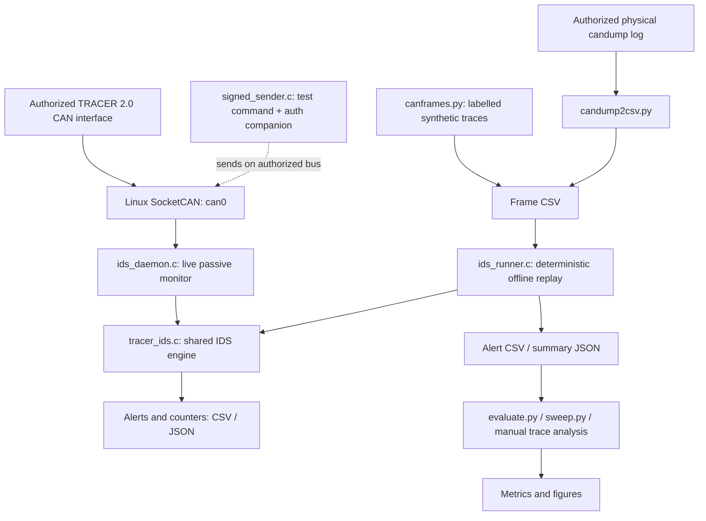

# TRACER-CAN-IDS

**Protocol-aware CAN intrusion detection and HMAC-SHA-256 authentication monitoring for the AgileX TRACER 2.0 unmanned ground vehicle**

> **Project status:** Research prototype (v3) · **Platform:** Linux / SocketCAN · **Evaluation:** Offline regression tests, generated CAN traces, and support for archived physical captures
>
> **Important:** This is a **passive monitoring system**, not an inline security gateway. Its alerts do **not** prevent the unmodified TRACER controller from receiving or acting on CAN commands. Do not use the prototype as a replacement for hardware safety controls or receiver-enforced authentication.

## Overview

Commercial unmanned ground vehicles (UGVs) can expose CAN interfaces for motion control, operating-mode selection, and status reporting. Classical CAN provides message identifiers and arbitration but does not natively authenticate the transmitting node. A device with access to the bus can therefore transmit frames that resemble legitimate control traffic.

**TRACER-CAN-IDS** is a research implementation that examines this attack surface on the **AgileX TRACER 2.0**. It combines:

- A **rule-based intrusion detection engine** grounded in documented and observed CAN identifiers, timing, and command semantics.
- **HMAC-SHA-256 companion-frame monitoring** for selected commands, including a sequence-based freshness check.
- A **live SocketCAN monitor** and a **deterministic offline replay harness** using the same C detection engine.
- Reproducible **software regression tests, synthetic-trace evaluations, sensitivity sweeps, host-side authentication benchmarks, and figures**.
- Tools to **convert and inspect authorized physical CAN recordings**, with explicit limitations on physical event scoring.

The project is intended for **academic research, defensive evaluation, education, and controlled laboratory experiments**. It is **not production-ready** or a general-purpose IDS for arbitrary CAN devices.

### Contents

- [System architecture](#system-architecture)
- [Security model and detection rules](#security-model-and-detection-rules)
- [Authentication companion-frame format](#authentication-companion-frame-format)
- [Repository structure](#repository-structure)
- [Requirements](#requirements)
- [Quick start: reproduce the software evaluation](#quick-start-reproduce-the-software-evaluation)
- [Offline CAN-trace replay](#offline-can-trace-replay)
- [Reusing the detection engine](#reusing-the-detection-engine)
- [Physical CAN captures and experimental validation](#physical-can-captures-and-experimental-validation)
- [Configuration and default thresholds](#configuration-and-default-thresholds)
- [Reproducibility and interpretation of results](#reproducibility-and-interpretation-of-results)
- [Security, safety, and limitations](#security-safety-and-limitations)
- [Research manuscript and AI assistance](#research-manuscript-and-ai-assistance)
- [Contributing and reuse](#contributing-and-reuse)

## System architecture



**Two execution paths use the same detection logic:**

1. **Live monitoring:** `ids_daemon` reads CAN frames from an authorized SocketCAN interface, passes them to `ids_feed()`, performs timeout processing through `ids_tick()`, and records alerts.
2. **Offline evaluation:** `ids_runner` replays timestamped CSV frames through the same engine without using wall-clock timing. Python scripts generate test vectors, invoke the runner, score alerts, and create plots.

The **authenticated sender** demonstrates how selected command frames can be followed by a separate authentication frame. **The robot's original controller does not verify that companion frame**; verification happens at the passive monitor.

## Security model and detection rules

The baseline attacker is assumed to have **physical or otherwise authorized test access to the CAN bus** and knowledge of documented frame formats, but not the shared experimental HMAC key. This repository evaluates specified traffic patterns; it does not establish protection against all adversaries or attack combinations.

| Rule / alert | What the monitor checks | Important interpretation |
|---|---|---|
| R1 · `FLOOD` | Excessive traffic rate for a CAN identifier | Detects a traffic anomaly; it does **not** establish that the robot suffered denial of service. |
| R2 · `MODE_CHANGE` / `NO_AUTH` | Mode-command transitions (`0x421`) and their authentication | Under the default authentication-aware configuration, an unsigned mode command yields `NO_AUTH`; a validly authenticated transition is not automatically malicious. |
| R3 · `VEL_JUMP` | Large change between successive linear-velocity commands (`0x111`) | Threshold-based plausibility check; legitimate operation may also produce abrupt changes. |
| R4 · `REPLAY` / `STALE_SEQ` | Replay-related conditions, including stale authenticated sequence values | `STALE_SEQ` identifies a previously used/non-fresh sequence even when the MAC is valid. |
| R5 · `UNKNOWN_ID` | Identifier absent from the TRACER-specific allowlist | Does not identify the sender of a frame that uses an allowed identifier. |
| R6 · `NO_AUTH` | Selected commands missing a valid companion within the configured window | Detection only; does not block the command at the controller. |
| R7 · `BAD_MAC` | Companion fails HMAC verification | The tag is only 32 bits; security depends on key protection and threat assumptions. |
| R8 · `BURST` | Nontrivial motion command after a sufficiently long idle interval | Context-dependent warning, not proof of compromise. |
| R9 · `BRUTE_FORCE` | Repeated failed companion-tag checks within a window | Reports repeated invalid-MAC attempts; does not imply key recovery. |

The default **14-identifier allowlist** and protocol identifiers are defined in [`tracer_ids.h`](tracer_ids.h). Notable identifiers include `0x111` (motion command), `0x112` (project-specific authentication companion), `0x211` (system status), `0x221` (motion feedback), `0x241` (RC-transmitter state), `0x421` (mode setting), and `0x441` (error clearing). The original `0x111` byte 7 is **reserved**; it is **not** a native rolling counter.

## Authentication companion-frame format

The prototype adds a separate **8-byte CAN frame at ID `0x112`** to selected host-to-robot commands:

| Command ID | Prototype monitoring scope |
|---|---|
| `0x111` | Motion command |
| `0x421` | Operating-mode command |
| `0x441` | Error-clear command |

The MAC input is assembled as **2 bytes of CAN ID + 8 bytes of command payload (zero-padded as necessary) + 2 bytes of sequence number**. The sender computes **HMAC-SHA-256**, and places the **first 4 bytes** in the companion frame.

| Companion byte(s) | Field | Length |
|---|---|---:|
| `0–3` | Truncated HMAC-SHA-256 tag | 4 bytes |
| `4–5` | Monotonic sequence value | 2 bytes |
| `6–7` | Auxiliary low-order timestamp | 2 bytes |

The timestamp field is **not authenticated and is not used for the freshness decision** in the current implementation. Sequence freshness is evaluated against the monitor's current sequence state. The **shared default key is hard-coded for reproducible testing** in [`tracer_ids.h`](tracer_ids.h) and mirrored by [`canframes.py`](canframes.py); **it must not be considered a production secret**. The implementation has no production-grade key provisioning, reboot synchronization, or receiver-side enforcement.

## Repository structure

The following files are present in this published source repository:

```text
.
├── tracer_ids.c / tracer_ids.h     # IDS rules, state and API
├── sha256.h                       # Standalone SHA-256 / HMAC-SHA-256
├── ids_daemon.c                   # Live SocketCAN monitor
├── signed_sender.c                # Authorized signed-command demonstration
├── ids_runner.c                   # Offline frame-CSV replay
├── test_v3.c                      # Eight C regression tests
├── bench_hmac.c                   # Host-side signing/verification benchmark
├── canframes.py                   # Labelled synthetic CAN traces
├── evaluate.py                    # Synthetic attack evaluation and Wilson CIs
├── sweep.py                       # Threshold sensitivity experiments
├── candump2csv.py                 # candump -L log to frame CSV
├── score_physical.py              # Preliminary capture-phase scoring
├── make_figures.py                # Figures generated from results files
├── Makefile                       # Compile and run regression tests
├── RUN_PROTOCOL.md                # Laboratory campaign protocol
├── AI_USAGE.md                    # AI assistance disclosure
└── README.md                      # This document
```

`.gitignore` excludes generated binaries, caches, and `results/` outputs. **Raw physical captures, their independent event annotations, and the paper's original physical dataset are not included in the current repository.** Some older documentation in the development kit referred to internal reviewer-response and reference files; those are not part of this published source snapshot.

## Requirements

For **offline reproduction** (no robot required):

- Ubuntu or another Linux distribution with **GCC**, **GNU Make**, and **Python 3**.
- Python packages **NumPy** and **Matplotlib** for figure generation. The core evaluation scripts otherwise use the Python standard library.
- No ROS, GPU, Jetson, robot, or CAN hardware is required for the software-only tests.

For **live observation** (optional):

- A TRACER 2.0 and a compatible, **authorized** USB-CAN/SocketCAN interface.
- Linux CAN networking and `can-utils` (`candump`) for traffic recording.
- An isolated, supervised laboratory environment with applicable motion safety precautions.

Check locally installed tools:

```bash
gcc --version
make --version
python3 --version
```

If you need isolated Python dependencies, create a virtual environment:

```bash
python3 -m venv .venv
source .venv/bin/activate
python -m pip install --upgrade pip
python -m pip install numpy matplotlib
```

> Ubuntu may require its `python3-venv` package before `python3 -m venv` works. No dependency lockfile is supplied; record Python and package versions when reporting reproduced results.

## Quick start: reproduce the software evaluation

These commands run **entirely offline** in the **repository root**.

### 1. Clone and build

```bash
git clone https://github.com/M-khalifa1/tracer-can-ids.git
cd tracer-can-ids
make
```

If the repository is private, cloning requires access to the `M-khalifa1` account or an authorized collaborator account. `make` compiles the C programs **in the repository root** and automatically runs the regression tests. To rerun just the tests:

```bash
./test_v3
# Expected summary for the reviewed v3 source:
# Result: 8 passed, 0 failed
```

The regression suite checks sequence handling, pending-authentication overwrite, stale-sequence detection, invalid-MAC escalation, authentication-aware mode changes, benign feedback, and configurable velocity thresholds. **Eight passing assertions are not equivalent to a measured detection rate on a real robot.**

### 2. Generate labelled synthetic attacks and score them

```bash
python3 evaluate.py
```

Expected outputs (created locally, not committed):

```text
results/atk_A1.csv ... results/atk_A9.csv  # Generated scenario traces (A3 not defined)
results/benign.csv                         # Generated benign traffic
results/metrics.json                       # Per-attack detection and Wilson 95% CIs
```

`evaluate.py` invokes the compiled `./ids_runner` and evaluates **A1, A2, A4–A9** using generated and labelled test events. It also reports an **alert-count-per-benign-frame metric** in a benign session; treat that metric as the script's defined proxy, **not an independently established frame-level classifier false-positive probability**. The example events are not independent physical runs.

### 3. Sweep detector thresholds

```bash
python3 sweep.py
# Output: results/sweeps.json
```

The sensitivity harness varies flooding, velocity-jump, idle/burst, and authentication-window settings while reprocessing test traces. **Interpret each curve according to the alert being scored**: for example, the current `burst_idle_ms` sweep scores `NO_AUTH` on its selected scenario, so it should **not** be reported as validated BURST-rule sensitivity without updating the scoring configuration. The repository does not currently produce a standalone ROC figure.

### 4. Benchmark authentication on your own host

```bash
mkdir -p results
./bench_hmac 200000 > results/hmac_bench_host.json
```

The benchmark reports signing distribution statistics (**min, mean, median, P99, max**) and verification statistics, in microseconds. It compares signing time to the **20,000 µs nominal command period**. The generated `platform` field initially contains a **`FILL_ME` placeholder**: replace it with your actual OS/CPU description before citing the numbers. These are **host computation measurements**, not CAN transmission, embedded execution, live alert latency, or end-to-end actuation delays. Results vary with host hardware and system load.

### 5. Generate figures

```bash
python3 make_figures.py
# Output: results/charts/*.png and *.pdf
```

Figures are created from available `results/metrics.json`, `results/sweeps.json`, and `results/hmac_bench*.json` files. Missing inputs are **skipped** with a message. These generated graphics describe **the input experiments**, not additional physical validation.

### 6. Clean the compiled programs (optional)

```bash
make clean
```

> **Reproduction boundary:** This workflow reproduces the **code-driven software experiments**. It **does not independently reproduce the physical-paper results** without the original CAN captures, operating-condition metadata, and event-level ground truth.

## Offline CAN-trace replay

`ids_runner` reads CSV files with the header:

```csv
ts_us,can_id,dlc,data_hex
1000000,0x111,8,00C8000000000000
```

Replay a previously prepared trace:

```bash
./ids_runner PATH_TO_FRAMES.csv results/replayed_alerts.csv
```

The runner writes an **alert CSV** and a **JSON summary** alongside it. Optional runtime configuration can be supplied as `key=value` arguments, for example:

```bash
./ids_runner PATH_TO_FRAMES.csv results/replayed_alerts.csv \
  flood_hz=200 vel_jump=600 auth_win_us=8000 seq_window=64 suppress=0
```

Use the same input CSV, detector revision, and configuration for meaningful comparisons. The replay engine does not require a CAN interface or wall-clock scheduling.

## Reusing the detection engine

The reusable core is [`tracer_ids.c`](tracer_ids.c) with [`tracer_ids.h`](tracer_ids.h) and [`sha256.h`](sha256.h). The `ids_daemon` and `ids_runner` programs are **adapters** around this engine, not alternative detection implementations.

Typical integration sequence (illustrative C fragment, not a standalone program):

```c
IDSConfig cfg;
ids_default_config(&cfg);
cfg.log_suppress = false;  /* Retain alerts during evaluation. */

IDS detector;
ids_init_cfg(&detector, DEFAULT_HMAC_KEY, &cfg);

/* For each validated CAN frame, with an appropriate microsecond timestamp: */
ids_feed(&detector, can_id, dlc, data, timestamp_us);

/* Periodically advance pending-authentication timers, including while idle: */
ids_tick(&detector, current_timestamp_us);
```

Applications may attach a CSV stream with `ids_set_csv()` and write counters using `ids_write_json()`. Because pending-authentication expiration and other conditions can emit alerts **inside** the engine, examine its output/counters rather than assuming one returned `Alert` always represents every event.

**Before adapting to another robot or CAN implementation**, revise and validate the identifier allowlist, command payload semantics, authentication policy, timing thresholds, test vectors, and safety model. Neither the default key nor the TRACER-specific rules should be reused unchanged for a production device.

## Physical CAN captures and experimental validation

The code supports replay of real **authorized** laboratory captures; physical robot operation and capture collection are **not** required for the offline quick start.

### Inspect an existing capture

Capture input must use the `candump -L` format. If you already possess an authorized capture:

```bash
mkdir -p results
python3 candump2csv.py PATH_TO_SESSION.log results/session_frames.csv
./ids_runner results/session_frames.csv results/session_alerts.csv suppress=0
```

To collect a **new benign** capture in a controlled lab, first configure the authorized `can0` interface using the device manufacturer's documented bitrate and your laboratory procedures. Then, in the foreground:

```bash
mkdir -p results
candump -L can0 > results/session.log
# Press Ctrl+C to stop capture.
```

The documented TRACER 2.0 CAN interface operates at **500 kbit/s**. Do **not** execute motion or injection demonstrations on an active robot without appropriate authorization, physical safety controls, and supervision. The `signed_sender` example **issues motion commands**; it is not part of the safe offline quick start.

### Preliminary phase scoring

[`score_physical.py`](score_physical.py) accepts a recording plus phase labels and optional repeat counts, reusing the offline detector's alert types. It segments a recording by gaps **between consecutive captured CAN frames** (default threshold: 1.5 seconds).

**Important limitations:**

- A robot can continue transmitting background status/feedback frames during a supposed test pause, preventing the required frame-free gap. Phase segmentation may then fail.
- The current scoring procedure may count several alerts within one phase and cap the count at the declared number of repetitions. This is **not equivalent to one-to-one matching of alerts against separately timestamped attack events**.
- For publication-grade physical detection rates and confidence intervals, validate phase boundaries and provide a timestamped event manifest, per-event matching, denominators, and preserved raw captures.

Use [`RUN_PROTOCOL.md`](RUN_PROTOCOL.md) as a **laboratory planning reference**, not as independent evidence that every physical scenario has been reproduced from the public repository. The individual attack-injection scripts and raw original campaign recording are not included here.

## Configuration and default thresholds

Defaults are defined in [`tracer_ids.h`](tracer_ids.h) and loaded through `ids_default_config()`. `ids_runner` accepts configuration overrides without modifying C source.

| Parameter | Default | Meaning |
|---|---:|---|
| `flood_hz` | `200` Hz | Rate alarm operating threshold |
| `flood_win_us` | `100000` µs | Rate measurement window |
| `vel_jump` | `600` mm/s | Successive-command linear-velocity delta threshold |
| `auth_win_us` | `8000` µs | Pending companion authentication timeout |
| `burst_idle_ms` | `300` ms | Idle duration considered by BURST warning |
| `burst_vel_min` | `150` mm/s | Motion magnitude considered by BURST warning |
| `seq_window` | `64` | Accepted forward sequence-number window (`0` disables check) |
| `brute_win_us` | `1000000` µs | Invalid-MAC aggregation window |
| `brute_count` | `5` | Invalid-MAC count for escalation |
| `require_auth_mode` | `1` | Authentication-aware handling of mode transitions |
| `suppress` | `0` (offline evaluation) | Preserve every alert in evaluation logs; live default suppresses close repeated alerts |

These settings are **research operating points**, not universally safe values. Different firmware revisions, host scheduling, bus utilization, and legitimate motion profiles can change both alerting behavior and operating risks.

## Reproducibility and interpretation of results

| Claim or artifact | Reproducible from this repository alone? | Evidence needed |
|---|---|---|
| Eight C regression checks | **Yes** | `make` and `./test_v3` |
| Synthetic per-scenario metrics | **Yes** | `evaluate.py` + generated traces + compiled runner |
| Threshold sensitivity on generated traces | **Yes** | `sweep.py` + detector revision |
| Host HMAC measurement | **Yes, on a local host** | `bench_hmac` + CPU/OS/toolchain and runtime conditions |
| Synthetic plots | **Yes** | `make_figures.py` + generated result files |
| Offline alerts from a supplied real capture | **Yes, if the capture is supplied** | `candump -L` log or correctly formatted frame CSV |
| Paper's physical event-level results | **Not with current repository alone** | Original raw capture, scripted event timestamps/labels, scoring protocol, and configuration |
| Online detector latency or physical command blocking | **Not established** | Separate instrumented experiments or a receiver-enforcing gateway |

For reproducible research, retain at least the Git commit hash, complete invocation, toolchain/OS information, detector parameters, raw capture checksums (where available), event annotations, and generated metric JSON. Example environment checks:

```bash
git rev-parse HEAD
gcc --version
python3 --version
```

The accompanying research manuscript describes an archived physical CAN campaign and offline event-to-alert correspondence. **Those results must not be conflated with this repository's generated-trace output or presented as independently verified by a clean clone.**

## Security, safety, and limitations

- **Passive only:** Alerts do not block frames or enforce authentication at the original controller.
- **Experimental key:** The example shared HMAC key is in source code. Do not reuse it as a deployment secret. A real system requires secure provisioning, rotation, and explicit reset/freshness management.
- **Short MAC:** The companion carries a **32-bit truncated tag**, with security and online-guessing implications that must be evaluated under the actual threat model.
- **Timing and throughput:** The live daemon polls a SocketCAN socket and processes frames in software. No guarantee is given for lossless capture, real-time P99 latency, or bounded behavior under sustained overload; alert I/O and host scheduling may become bottlenecks.
- **Context sensitivity:** Threshold rules can raise warnings on benign but unusual operating patterns and miss attacks that remain below their thresholds.
- **Single platform:** The allowlist, payload interpretation, and default settings are TRACER-specific; portability requires protocol validation and retesting.
- **Physical evidence:** Generated test traces and offline alerts do not by themselves prove physical robot movement, denial of service, or prevention.
- **Responsible operation:** Use only on systems you own or are authorized to test. Keep motion-capable demonstrations isolated and supervised. Review raw captures for private or sensitive infrastructure information before sharing.

## Research manuscript and AI assistance

**Related manuscript**

> Mahmoud Ahmed Khalifa, Ahmad Taher Azar, and Walid El-Shafai. **“Experimental CAN Security Evaluation of a Commercial Unmanned Ground Vehicle with Intrusion Detection and Authentication Monitoring.”** Research manuscript, 2026.

**Publication link / DOI:** _Add a verified public link when available._ The manuscript is not included in this repository, and the presence of a manuscript does not imply acceptance or publication.

**AI assistance disclosure:** Generative AI tools were used for aspects of brainstorming, debugging guidance, experimental planning support, and writing/editing assistance. Researchers reviewed the outputs against their expertise and available evidence and retain responsibility for experimental execution, accuracy, interpretations, and claims. See [`AI_USAGE.md`](AI_USAGE.md) for the project disclosure.

If you use this work, cite the relevant published paper **once its bibliographic details are confirmed** and clearly state which evaluations you independently reproduced.

## Contributing and reuse

Issues and pull requests for **documentation, reproducibility, correctness, robustness, and defensive evaluation** are welcome subject to repository access permissions. Useful contributions include independent test vectors, event-level physical scoring, safer key handling, repeatable benchmarking, and improved capture metadata. Please include steps to reproduce and describe any change in detector outputs or thresholds.

**License:** No open-source license is included in the current repository. Source availability—even if the repository is later made public—does **not** by itself grant redistribution, modification, or commercial-use rights. A license should be selected and added by the authorized copyright holder(s) before advertising the project as open-source or permitting broad reuse.

**Maintainer / repository:** [M-khalifa1/tracer-can-ids](https://github.com/M-khalifa1/tracer-can-ids)
